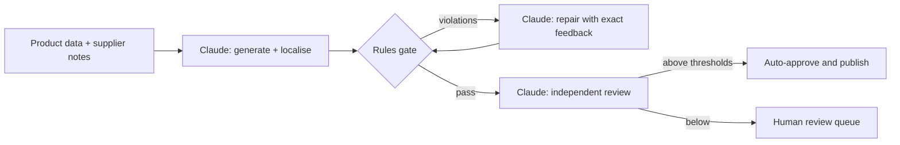
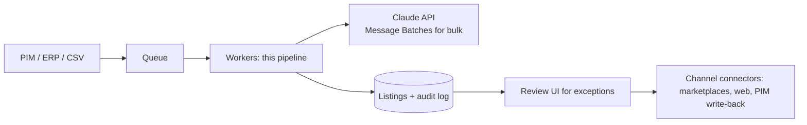

# Catalogue Content AI (built with Claude)

**Problem addressed:** product content for large catalogues is written by hand per market and language, which slows time-to-shelf and produces inconsistent or non-compliant listings.

**Solution:** basic product data goes in. Claude generates native-quality, localised, channel-ready listings (title, bullets, description, attributes, SEO terms, alt text, legal notice). A deterministic rules gate and a second, independent Claude review check every listing. Failures are repaired automatically by Claude, and only low-confidence listings go to a human.

All data in this repo is synthetic (fictional brand "Nordwell Retail" and invented products). No real customer, client or personal data.

## Run it

Requires Node 20+. No `npm install` needed (zero dependencies).

```powershell
copy .env.example .env      # then put your ANTHROPIC_API_KEY in .env
node server.js              # open http://localhost:3000
node cli.js                 # or: batch run -> output/listings.json + listings.csv
node --test test/           # unit tests
```

Without an API key the app starts in a clearly labelled **offline mock** mode (English placeholder output) so the UI can be tested. Real demos need a key. Optional: `CLAUDE_MODEL` (default `claude-sonnet-4-5`).

## Demo script (5 minutes)

1. Open the UI. The 7 products carry deliberately bad supplier notes: "cures eczema", "#1 seller", "free shipping", "safe for all ages", "boosts immunity".
2. Select all products and all 5 markets (US, DE, FR, ES, JP). Click **Generate listings**.
3. Open a cell, for example GlowRoot x Amazon DE. The left panel shows the risky input and **Claims Claude removed**. The right panel shows a native German listing.
4. In the quality gate panel, look at the "Generation attempts" line. It shows when Claude's first attempt broke a rule and was repaired automatically.
5. Scroll to **Business impact** for the time and cost comparison and the 50,000-listing projection.
6. Add your own product with the form to show that it generalises.

## How Claude is used (it is the engine, not an add-on)

| Step | Claude's job | Notes |
|---|---|---|
| Generate + localise | Writes the full listing natively per market from specs, brand voice, glossary and channel rules | Forced tool use returns schema-valid JSON. System prompt is prompt-cached, so it is shared across all SKUs in a market |
| Claim screening | Drops unsupported, promotional and medical claims and reports each in `claims_removed` | Supplier notes are treated as untrusted |
| Self-repair | Receives the exact rule violations and returns a corrected listing (up to 2 repairs) | Closed loop with the validator |
| Independent review | A separate call scores faithfulness, compliance, brand voice and localisation, and lists unsupported claims | Temperature 0, strict rubric |

Deterministic code (`src/validator.js`) enforces what must never depend on a model: character limits, banned terms per language, medical-claim terms, imperial units in metric markets, required attributes and legal notices.

**Auto-approve rule:** zero rule errors, all four review scores above threshold (85/85/70/70) and no unsupported claims. Anything else is routed to a human.



## Measurable impact

The app computes impact from the run itself: measured tokens, seconds and review outcomes. Manual baselines and prices are explicit assumptions in [data/assumptions.json](data/assumptions.json) and should be replaced with your own measured numbers.

| Metric | Manual (assumed) | With Claude |
|---|---|---|
| Effort per product-market listing | 40 min (write 20, translate 12, QA 8) | ~1 min human review if auto-approved, ~6 min if flagged, plus seconds of machine time |
| Cost per listing at 30 EUR/h | 20 EUR | API cost (cents) plus review labour |
| Compliance defects reaching channels | Found after rejection | Caught before publish by the rules gate and the review |
| Consistency across markets | Varies per writer | One brand voice and glossary applied everywhere |

The UI shows live figures for the run you just did and a projection to 10,000 SKUs x 5 markets = 50,000 listings. Treat the headline savings as a model: they scale directly with your real manual baseline and your auto-approval rate, both of which should be measured in a pilot.

## Path to production



- **Integration:** replace `data/products.json` with a PIM/ERP connector (Akeneo, Salsify, SAP and similar). Publish through marketplace APIs or a PIM write-back. The pipeline function `generateListing()` is the single unit of work, so it drops into any queue worker.
- **Scale:** run workers in parallel behind a queue. Use the Message Batches API for catalogue-wide backfills, where it is cheaper and asynchronous. Keep real-time calls for new-product launches. Prompt caching already cuts the input cost of the shared brand and market prompt.
- **Cost control:** the cost per listing is measured in the app (`src/roi.js`). Use a smaller model for the review step and for simple categories, and a larger model for regulated categories. Set a budget cap per run and a concurrency cap (the server already limits in-flight requests).
- **Quality:** add per-market golden sets, native-speaker spot checks, and track the auto-approval rate and the post-publish rejection rate as production KPIs. Add vision input so Claude extracts attributes from product images and writes alt text from the actual image.
- **Security and privacy:**
  - The API key stays server-side in env vars or a secret manager and never reaches the browser.
  - The server binds to localhost and sets a strict CSP and security headers. The UI renders output with `textContent`, so model output cannot inject markup.
  - Request size and field lengths are bounded. Static file paths are traversal-protected.
  - Product text is passed to Claude as delimited, untrusted data, with a prompt-injection instruction in both prompts.
  - Nothing is persisted. In production, add SSO, role-based access, an audit log of every generated and approved listing, and a data-processing agreement covering the catalogue data. Do not send personal data. Catalogue content is normally non-personal.
- **Governance:** the human-in-the-loop queue, the audit trail and the per-market rule files ([data/markets.json](data/markets.json), [data/category_rules.json](data/category_rules.json)) give compliance teams a place to own and update the rules without code changes.

## Limitations (prototype)

- Marketplace rules in `data/` are simplified examples, not the full policies.
- The banned and medical term lists are small illustrative sets. Claude's own screening and review cover the long tail, but production needs maintained lists per market.
- Monetary figures depend on the assumptions file. Validate them with a pilot on your own baseline.
- No image input yet (listed as a next step).

## Layout

```
server.js            HTTP server + API (config, generate, roi)
cli.js               batch runner
src/claude.js        Claude API client (tool use, prompt caching, retries)
src/prompts.js       system prompts + tool schemas
src/pipeline.js      generate -> validate -> repair -> review -> gate
src/validator.js     deterministic compliance rules
src/roi.js           measured business-impact model
src/mock.js          offline mock for UI testing without a key
public/              UI (plain HTML/JS/CSS)
data/                synthetic products, markets, category rules, assumptions
test/                unit tests
```
