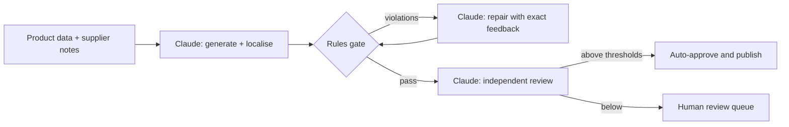
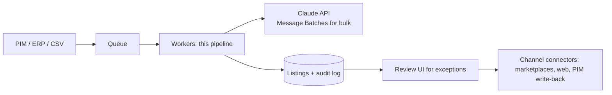

# Catalogue Content AI (built with Claude)

**Problem addressed:** product content for large catalogues is written by hand per market and language, which slows time-to-shelf and produces inconsistent or non-compliant listings.

**Solution:** basic product data goes in. Claude generates native-quality, localised, channel-ready listings (title, bullets, description, attributes, SEO terms, alt text, legal notice). A deterministic rules gate and a second, independent Claude review check every listing. Failures are repaired automatically by Claude, and only low-confidence listings go to a human. Every generation and every human decision is persisted, so the review queue survives restarts and spans both the UI and CLI batch runs.

All data in this repo is synthetic (fictional brand "Nordwell Retail" and invented products). No real customer, client or personal data.

## Run it

Requires Node 20+. No `npm install` needed (zero dependencies).

```powershell
copy .env.example .env      # then put your ANTHROPIC_API_KEY in .env
node server.js              # open http://localhost:3000
node cli.js                 # or: batch run -> output/listings.json + listings.csv
node --test test/           # unit tests
```

Without an API key the app starts in a clearly labelled **offline mock** mode (English placeholder output) so the UI can be tested. Real demos need a key. Optional: `CLAUDE_MODEL` (default `claude-sonnet-4-5`).

**If you cloned/pulled this repo fresh:** everything below (`GATEWAY_URL`, `ANTHROPIC_API_KEY`, the `AZURE_*` vars) is read purely from environment variables via `.env` — nothing is hardcoded in source, and `.env` is git-ignored on purpose, so it never comes with the repo. The app runs immediately with no setup at all (offline mock mode); to get **live** Claude output, pick one:
- **Simplest, no org dependency:** put your own `ANTHROPIC_API_KEY=sk-ant-...` in `.env`. Nothing else needed — this skips the gateway and Azure Key Vault entirely.
- **Using your org's gateway/Key Vault (like this deployment does):** you need your *own* Azure AD app registration (or access granted to an existing one) with "get secret" on the vault, plus whatever network/VPN access the gateway itself requires (see the Azure Key Vault and Internal LLM gateway sections below for exactly which `AZURE_*`/`GATEWAY_URL` vars to set). Ask whoever administers your org's vault/gateway for these rather than copying another teammate's `.env` — a client secret is a real credential and sharing it in chat, email, or a committed file defeats the point of keeping it out of git. If your team *does* want to share one set of credentials deliberately, put them in a password manager or your org's secret store, not plain text.

**Internal LLM gateway (optional):** set `GATEWAY_URL` to route every Claude call (generation and key verification alike) through an internal proxy instead of `api.anthropic.com` directly — common in organisations that front Anthropic with their own gateway for billing/access control. The client assumes the gateway mirrors Anthropic's own Messages API shape (`POST {GATEWAY_URL}/v1/messages`, same `x-api-key` header) — see `getApiUrl()`/`verifyApiKey()` in [src/claude.js](src/claude.js) if your gateway's actual contract differs (e.g. a different auth header or path). When a gateway is configured, `CLAUDE_MODEL` must be set to a model name *it* recognises (not necessarily Anthropic's native ids — e.g. an org-specific suffix), and the "Connect Claude" key format check no longer requires `sk-ant-...`, since a gateway token can look like anything. Confirmed working in production (all 10 demo products × 5 markets generated live) against a LiteLLM gateway fronting Claude via Azure AI, through a corporate TLS-inspecting proxy (Zscaler). That combination needed four adjustments, all already built in and scoped to gateway mode only (direct-Anthropic behaviour is unchanged):
- `tool_choice` falls back to `{ type: "auto" }` (that backend rejects forced `"tool"`/`"any"` choice) — if the model occasionally replies in plain text instead of calling the tool, `callTool()` retries with an explicit nudge rather than failing the generation outright.
- `temperature` is omitted entirely (rejected as "deprecated for this model").
- Response latency was far higher and more variable than direct Anthropic (seconds up to ~70s per call), so `verifyApiKey()` uses a longer timeout in gateway mode.
- The TLS-inspecting proxy intermittently produced a transient `ConnectTimeoutError` on individual connection attempts; `verifyApiKey()` now retries like `callTool()` already did, instead of failing outright on one bad connection attempt (this only matters for key verification at startup/"Connect Claude" — a one-shot call with no other chance to recover).

**Azure Key Vault (optional):** instead of putting `ANTHROPIC_API_KEY` in `.env`, both `server.js` and `cli.js` will fetch it from Azure Key Vault at startup if `AZURE_TENANT_ID`, `AZURE_CLIENT_ID`, `AZURE_CLIENT_SECRET` and `AZURE_KEY_VAULT_URL` are set (see `.env.example`) — a plain REST call (Azure AD client-credentials grant, then one Key Vault GET), no `@azure/*` SDK, so the project stays dependency-free. The service principal needs "get secret" on the vault (RBAC role **Key Vault Secrets User**, or a classic access policy with Get on secrets). `.env`/a manually pasted key always wins — the vault is only consulted when no key is already set. The fetched key is verified against the Anthropic API before use; any failure (bad secret, network, permissions) is logged and the app falls back to offline mock mode rather than crashing. `AZURE_CLIENT_SECRET` is itself a credential: keep it out of `.env` in anything beyond local testing — use your platform's own secret injection (e.g. an Azure App Service / Container Apps secret setting) instead.

## Demo script (5 minutes)

The UI is organised as tabs (Source products, Markets & generate, Results, Review queue, Business impact) instead of one long scrolling page — click a tab to jump straight to that step; generating listings automatically switches you to Results.

1. Open the UI, on the **Source products** tab — 5 products shown as tiles. They carry deliberately bad supplier notes: "cures eczema", "#1 seller", "free shipping", "safe for all ages", "boosts immunity".
2. Go to **Markets & generate**, with all products and all 3 markets (Amazon US, Amazon DE, Amazon ES) selected by default. Click **Generate listings** (this switches you to the Results tab automatically).
3. Open a cell, for example AuraBuds Pro x Amazon DE. The left panel shows the risky input and **Claims Claude removed**. The right panel shows a native German listing.
4. In the quality gate panel, look at the "Generation attempts" line. It shows when Claude's first attempt broke a rule and was repaired automatically.
5. Scroll to **Business impact** for the time and cost comparison and the 50,000-listing projection.
6. Add your own product with the form to show that it generalises.
7. Scroll to **Human review queue**, open one of the flagged listings, edit a field (or leave it as-is), and Approve or Reject. The decision, the reviewer name and any note are saved to disk immediately — reload the page or restart the server and the queue is unchanged.
8. Back in **Source products**, click **Edit** on a product (brand, name, specs and supplier notes are all editable; **Remove** drops a product from this session's list), change a spec (e.g. a battery life or capacity figure) and Save. Its listings flip to **Stale** in the review queue; filter to "Stale (source changed)" and click **Regenerate**.
9. Pick **Audience: Professional / business buyer** (or Student, or Premium) above Generate listings, and run the same product again. It's stored as a separate variant from the general version — compare them side by side in the review queue, which now shows an Audience column.

## How Claude is used (it is the engine, not an add-on)

| Step | Claude's job | Notes |
|---|---|---|
| Generate + localise | Writes the full listing natively per market from specs, brand voice, glossary and channel rules | Forced tool use returns schema-valid JSON. System prompt is prompt-cached, so it is shared across all SKUs in a market |
| Claim screening | Drops unsupported, promotional and medical claims and reports each in `claims_removed` | Supplier notes are treated as untrusted |
| Self-repair | Receives the exact rule violations and returns a corrected listing (up to 2 repairs) | Closed loop with the validator |
| Independent review | A separate call scores faithfulness, compliance, brand voice and localisation, and lists unsupported claims | Temperature 0, strict rubric |

Deterministic code (`src/validator.js`) enforces what must never depend on a model: character limits, banned terms per language, medical-claim terms, imperial units in metric markets, required attributes and legal notices.

**Auto-approve rule:** zero rule errors, all four review scores above threshold (85/85/70/70) and no unsupported claims. Anything else is routed to a human. Every result and review-queue entry shows a plain-language "Why this needs review" explanation naming the exact gate(s) it failed — including the common one in offline mock mode, where brand-voice and localisation scores are fixed low placeholders (no real review ran) and everything is therefore always routed to review.

**Human review queue:** every generation (from the UI or the CLI) is persisted to `data/store/` with its gate violations and Claude review. The queue lists everything not yet auto-approved; clicking **Open** brings up the listing in a popup where a reviewer can edit any field (re-validated against the same rules gate) and approve or reject, with their name and note recorded — the popup confirms explicitly when a decision was made against an edited version ("listing was edited before this decision"). Approvals/rejections never overwrite history — the prior version is kept, and every event is also appended to `data/store/audit.jsonl`. **Approve all pending** bulk-approves everything with status "needs review" as-is (in one confirm step), skipping anything flagged **Stale** so outdated content never gets rubber-stamped — each bulk decision is recorded individually with a "Bulk approved" note, same audit trail as a one-by-one approval.

**Stale-listing detection:** each stored listing keeps a hash of the exact product fields it was generated from. Editing a catalogue product's specs or supplier notes (in the Source products panel, simulating a PIM/ERP push) changes that hash, so any already-generated listing for that product is flagged **Stale** in the review queue (filterable) and in its detail view, with a one-click **Regenerate** that re-runs it against the current data. This is a prototype of pain point #9 (updating existing catalogs): a real integration would raise the same flag from a PIM webhook or a nightly diff instead of a manual edit.

**Personalised content by audience:** the same product data can be generated for a named audience segment (general shopper, professional/business buyer, student, premium/gift buyer — [data/audiences.json](data/audiences.json)) via a dropdown next to Generate listings, or `--audiences` on the CLI. The audience only steers tone and framing (added to the system prompt, see `generationSystem` in [src/prompts.js](src/prompts.js)); every compliance and brand rule still applies, and the independent review is told the intended audience so it doesn't penalise an appropriate tone shift as "off brand". Each (product, market, audience) combination is stored and reviewed independently, so variants sit side by side in the review queue instead of overwriting one another.



## Measurable impact

The app computes impact from the run itself: measured tokens, seconds and review outcomes. Manual baselines and prices are explicit assumptions in [data/assumptions.json](data/assumptions.json) and should be replaced with your own measured numbers.

| Metric | Manual (assumed) | With Claude |
|---|---|---|
| Effort per product-market listing | 40 min (write 20, translate 12, QA 8) | ~1 min human review if auto-approved, ~6 min if flagged, plus seconds of machine time |
| Cost per listing at 30 EUR/h | 20 EUR | API cost (cents) plus review labour |
| Compliance defects reaching channels | Found after rejection | Caught before publish by the rules gate and the review |
| Consistency across markets | Varies per writer | One brand voice and glossary applied everywhere |

The UI shows live figures for the run you just did and a projection to 10,000 SKUs x 5 markets = 50,000 listings. Treat the headline savings as a model: they scale directly with your real manual baseline and your auto-approval rate, both of which should be measured in a pilot.

## Path to production



- **Integration:** replace `data/products.json` with a PIM/ERP connector (Akeneo, Salsify, SAP and similar). Publish through marketplace APIs or a PIM write-back. The pipeline function `generateListing()` is the single unit of work, so it drops into any queue worker.
- **Scale:** run workers in parallel behind a queue. Use the Message Batches API for catalogue-wide backfills, where it is cheaper and asynchronous. Keep real-time calls for new-product launches. Prompt caching already cuts the input cost of the shared brand and market prompt.
- **Cost control:** the cost per listing is measured in the app (`src/roi.js`). Use a smaller model for the review step and for simple categories, and a larger model for regulated categories. Set a budget cap per run and a concurrency cap (the server already limits in-flight requests).
- **Quality:** add per-market golden sets, native-speaker spot checks, and track the auto-approval rate and the post-publish rejection rate as production KPIs. Add vision input so Claude extracts attributes from product images and writes alt text from the actual image.
- **Security and privacy:**
  - The API key stays server-side in env vars or a secret manager and never reaches the browser.
  - The server binds to localhost and sets a strict CSP and security headers. The UI renders output with `textContent`, so model output cannot inject markup.
  - Request size and field lengths are bounded. Static file paths are traversal-protected.
  - Product text is passed to Claude as delimited, untrusted data, with a prompt-injection instruction in both prompts.
  - Generated listings and human review decisions are persisted to `data/store/` (JSON snapshot + an append-only `audit.jsonl`), git-ignored by default. There is no authentication on the review endpoints yet and the reviewer "name" is free text. In production, move the store to a real database, put it behind SSO and role-based access, and cover the catalogue data with a data-processing agreement. Do not send personal data. Catalogue content is normally non-personal.
- **Governance:** the human-in-the-loop queue (`src/store.js`, the "Human review queue" panel), its audit trail and the per-market rule files ([data/markets.json](data/markets.json), [data/category_rules.json](data/category_rules.json)) give compliance teams a place to own and update the rules without code changes.

## Limitations (prototype)

- Marketplace rules in `data/` are simplified examples, not the full policies.
- The banned and medical term lists are small illustrative sets. Claude's own screening and review cover the long tail, but production needs maintained lists per market.
- Monetary figures depend on the assumptions file. Validate them with a pilot on your own baseline.
- The review queue has no authentication: anyone who can reach the server can approve or reject. Fine for a local pilot, not for shared/production use.

## Layout

```
server.js            HTTP server + API (config, generate, roi, review queue)
cli.js               batch runner
src/claude.js        Claude API client (tool use, prompt caching, retries)
src/azureKeyVault.js  optional: fetch ANTHROPIC_API_KEY from Azure Key Vault at startup
src/prompts.js       system prompts + tool schemas
src/pipeline.js      generate -> validate -> repair -> review -> gate
src/validator.js     deterministic compliance rules
src/roi.js           measured business-impact model
src/mock.js          offline mock for UI testing without a key
src/store.js         persistence for generated listings + human review decisions
public/              UI (plain HTML/JS/CSS)
data/                synthetic products, markets, category rules, audiences, assumptions
data/images/          default per-product photo (data/images/<id>.jpg), auto-attached by server.js if present
data/store/           (git-ignored) persisted listings.json + audit.jsonl, created on first run
test/                unit tests
```
